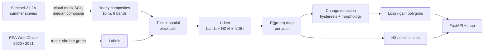

# Tashkent Green Watch 🌳🛰️

**Green-cover segmentation and change detection for Tashkent from Sentinel-2 imagery.**
A U-Net model maps tree and shrub cover every summer (2019–2025), finds where green areas
were lost or gained, and aggregates the results to H3 hexagons and districts. A FastAPI
service and a map interface (UZ / RU / EN) present everything.

> 🇷🇺 Русская версия: [README.ru.md](README.ru.md)

---

## Why

Tashkent is building a tree-by-tree digital registry ([green.tashkent.uz](https://green.tashkent.uz)),
and from 2026 satellite monitoring is used nationally to detect illegal tree cutting. Field
inventory gives precise data for each tree, but it is slow and covers the city once.
**Satellite monitoring covers the whole city every season.** This project is a prototype of that
second layer:

- **where** green cover is shrinking (hotspot map, area in hectares),
- **how fast** (yearly time series per hexagon / district),
- **which patches to check first**: a list of loss polygons with area and confidence. A field team
  or the registry can then verify them.

## How it works



| Stage | What happens | Code |
|---|---|---|
| Data | Sentinel-2 L2A from Microsoft Planetary Computer (free). June–August scenes, clouds masked per pixel with SCL, processing-baseline 04.00 offset harmonised, median composite. ESA WorldCover on the same grid. | `greenwatch/data/download.py` |
| Dataset | Tiles of 256 px. Split by **spatial blocks** (1024 px), not random tiles, so neighbouring tiles cannot leak between train and test. | `greenwatch/data/tiles.py` |
| Model | U-Net (ResNet-34 encoder, ImageNet init, 8 input channels: B02 B03 B04 B08 B11 B12 + NDVI + NDBI). Masked BCE + Dice loss, flips/rotations, radiometric jitter to simulate year-to-year differences. Early stopping on val IoU; decision threshold tuned on val. Runs on Apple MPS. | `greenwatch/train.py`, `model.py` |
| Baseline | NDVI threshold, tuned for best F1 on the training set. Every model number is reported next to it. | `train.py::evaluate_all` |
| Inference | Sliding window with 50 % overlap and Hann blending (no tile seams). | `model.py::predict_scene` |
| Change | Loss = P ≥ 0.6 before **and** P ≤ 0.3 after (hysteresis), then morphological opening and minimum area 500 m². A loss is `confirmed` if the next year is still not green. | `greenwatch/change.py` |
| Aggregation | Green share per year, loss/gain m² per H3 cell (res 8 ≈ 0.74 km²) and per district (optional GeoJSON). | `greenwatch/aggregate.py` |
| Serving | FastAPI (`/api/meta`, `/api/hexagons`, `/api/changes/...`, `/api/point`) and a Leaflet map with no CDN dependency. | `greenwatch/api`, `web/` |

### Evaluation protocol

| Split | Imagery & labels | Question it answers |
|---|---|---|
| `val` | 2021, held-out blocks | early stopping, threshold tuning |
| `test` | 2021, unseen blocks | does it generalise **in space**? |
| `test_time` | **2020** imagery + 2020 labels, unseen blocks | does it generalise **in time**? Change detection depends on this. |

Change detection is also scored against **known synthetic construction events**: event recall and
pixel precision (`outputs/demo/stats/change_eval.json`).

## Results

> ⚠️ Fill this table after training on real data (`make download && make pipeline`, see
> `outputs/models/metrics.json`). The numbers below come from the **synthetic offline demo**. They only
> show that the pipeline works end to end; they say nothing about real-world accuracy.

| Split | U-Net IoU | U-Net F1 | NDVI IoU | NDVI F1 |
|---|---|---|---|---|
| test (real data) | _todo_ | _todo_ | _todo_ | _todo_ |
| test_time (real data) | _todo_ | _todo_ | _todo_ | _todo_ |
| test (synthetic demo, 12 epochs, CPU) | 0.756 | 0.861 | 0.794 | 0.885 |

Synthetic change detection: **21 / 27** construction events found, **99.7 %** pixel precision.
(Events smaller than ~40 px of green fall below what 10 m imagery can resolve.)

On synthetic data, the spectra are clean by design, so NDVI is a strong baseline. The real test is
WorldCover on Tashkent, where irrigated fields, lawns and trees all have high summer NDVI. There,
spatial context (shape, texture, neighbourhood) should give U-Net its advantage. Measure it; don't assume it.

## Quick start

```bash
conda create -n greenwatch python=3.11 -y && conda activate greenwatch
pip install -r requirements.txt

# 1) Offline demo on synthetic data (about 1 min)
make demo
make serve-demo          # → http://localhost:8000

# 2) Real data for Tashkent
make download            # Sentinel-2 2019–2025 + WorldCover (a few GB, 20–60 min)
make pipeline            # tiles → train (MPS) → infer → change → aggregate
make serve               # → http://localhost:8000
make mlflow              # experiment tracking UI → http://localhost:5000

make test                # unit tests + end-to-end pipeline + API
```

Change `config.yaml` to set the area, years, season, WorldCover classes counted as green (add `30`
for grassland), model and thresholds. For district statistics, put a GeoJSON of district boundaries at
`data/boundaries/districts.geojson` (with a `name` field).

Docker (API + map, outputs mounted read-only): `docker compose up --build`.

## Project structure

```
greenwatch/
  data/download.py    Sentinel-2 composites + WorldCover (STAC)
  data/synthetic.py   offline synthetic scenes with known ground truth
  data/tiles.py       tiling + spatial block split
  features.py         bands + spectral indices
  model.py            U-Net, checkpoints, sliding-window inference
  train.py            training, threshold tuning, U-Net vs NDVI evaluation
  infer.py            yearly probability maps + web overlays
  change.py           loss / gain detection and vectorisation
  aggregate.py        H3 / district / city statistics
  api/main.py         FastAPI
web/index.html        map UI (UZ / RU / EN)
tests/                pytest (incl. end-to-end run)
config.yaml           all parameters
```

## Limitations (honest)

- **10 m resolution.** The model sees green *areas* (parks, tree rows, yards), not individual trees.
  A single cut tree is invisible. This complements a per-tree registry; it does not replace it.
- **Labels are WorldCover, not ground truth.** WorldCover has about 75–77 % overall accuracy, with
  errors at edges and in mixed urban pixels. The model learns those errors too. Next step: hand-label
  a few hundred Tashkent points for the test set.
- **Phenology and dry summers** can look like loss. Hysteresis, the `confirmed` flag and summer-only
  composites reduce this, but don't eliminate it.
- **A loss is not a violation.** Permitted construction also removes green cover. To flag
  *illegal* removal, you would join the results with permits or cadastre data, which needs official access.

## Roadmap

- [ ] Hand-labelled Tashkent test set (stratified points, 2 annotators)
- [ ] Siamese / bi-temporal change model trained on detected events
- [ ] Super-resolution or higher-resolution imagery for street-tree rows
- [ ] Join with the tree registry: "registry says N trees here, canopy is gone"
- [ ] Scheduled seasonal runs + alerts per district

## Data & licences

Sentinel-2: © ESA Copernicus (free, open). ESA WorldCover: CC BY 4.0. Basemap: © OpenStreetMap contributors, © CARTO.
